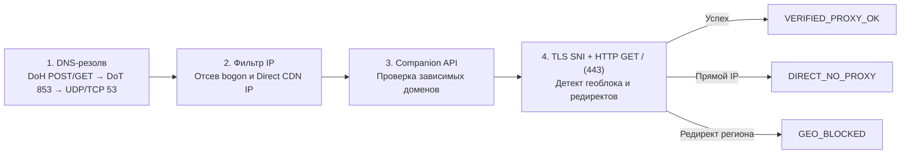

<div align="center">


# DNS Pulse for Windows

**Профессиональный десктопный инструмент для диагностики, автоподбора, локального сплит-туннелирования и управления Smart-DNS / DoH / DoT / SNI-Proxy на Windows 10/11.**

[](https://github.com/arch-revan-dev/DNS-Pulse-for-Windows/releases/latest)
[](https://github.com/arch-revan-dev/DNS-Pulse-for-Windows/actions/workflows/ci.yml)
[-0078D6?style=for-the-badge&logo=windows11)](https://github.com/arch-revan-dev/DNS-Pulse-for-Windows/releases)
[](https://dotnet.microsoft.com/)
[](LICENSE)

[Возможности](#-возможности) • [Быстрый старт](#-быстрый-старт-для-пользователей) • [Как работает 4-этапная проверка](#-как-работает-4-этапная-проверка) • [Авторежим и настройки](#-авторежим-трей-и-автозапуск) • [Архитектура](#-архитектура-проекта) • [Сборка из исходников](#-сборка-и-тестирование-для-разработчиков) • [Безопасность](SECURITY.md)

</div>

---

## 🎯 Зачем нужен DNS Pulse

Обычные DNS-тестеры измеряют лишь ping до `1.1.1.1` или `8.8.8.8` — это ничего не говорит о том, **откроется ли целевой сервис на практике**, не вернёт ли провайдер или CDN **прямой IP с геоблокировкой** и не «потечёт» ли IPv6-запрос мимо Smart-DNS.

**DNS Pulse** проверяет реальную сквозную цепочку (`DNS → Anti-Direct-IP → Companion API → TLS SNI + HTTP 443`), управляет локальным DNS-туннелем `127.0.0.1:53` с безопасным откатом системных настроек и умеет автоматически подбирать рабочий узел при старте Windows или потере доступности.

---

## ✨ Возможности

### Нативное приложение Windows 10/11 (`.NET 8 WPF MVVM`)
- **4-этапная диагностика без ложных срабатываний (`FourStageProber`)**:
  - Цепочка протоколов: `DoH (POST → GET)` → `DoT (TLS 853)` → `UDP 53` → `TCP 53`, а также прямые `SNI-Proxy 443` (`smartproxy://`) с реальным замером RTT.
  - Проверка **bogon/loopback** ответов, фильтр **Direct-IP** (отсекает прямое разрешение в стандартные CDN/Google/OpenAI подсети, если нужен именно прокси-обход), проверка companion API (например, `alkalimakersuite-pa.clients6.google.com` и `aistudio.google.com`) и реальный `TLS SNI + HTTP GET /` на порту `443` с детекцией редиректов геоблока (`/docs/available-regions`, `sorry/index`).
- **Авторежим («Автоподбор и автоподключение») и Failover Watchdog**:
  - В 1 клик (или автоматически при запуске) тестирует кандидатов, при необходимости запускает быстрый `/24` сканер, выбирает оптимальный `VERIFIED_PROXY_OK` узел и переключает локальный туннель, отслеживая деградацию в фоне.
- **Тестирование всего открытого раздела (`Тест раздела (N)`)**:
  - Проверяет все серверы текущей категории и активного фильтра/поиска в live-режиме с отображением прогресса и возможностью отмены (как на главной вкладке, так и в «Каталоге»).
- **Локальный DNS-туннель `127.0.0.1:53` и сплит-маршрутизация (`LocalDnsTunnelServer`, `WindowsNetworkAdapterService`)**:
  - Работа с кэшем, счётчиком запросов, ротацией узлов, очисткой входящих EDNS0 `OPT`-записей и опциональной блокировкой IPv6 `AAAA` / `HTTPS (SVCB)` запросов против DNS-утечек.
  - Автоматический бэкап и безопасное восстановление исходного состояния адаптеров (`restore_network_state.json`) + поддержка Windows NRPT split-routing.
  - Запуск по умолчанию с правами обычного пользователя (`asInvoker`); повышение прав (UAC) запрашивается только при применении системного DNS.
- **Bootstrap DNS и независимость от системного DNS (`BootstrapDnsResolver`)**:
  - Резолв DoH-хостов, онлайн-фидов и проверки обновлений выполняется через `1.1.1.1 / 8.8.8.8 / 9.9.9.9` (UDP 53 и IP-DoH) с автоматическим fallback на системный HTTP/прокси Windows при блокировке прямого UDP-канала.
- **База 1050+ DNS-серверов, сканер `/24` и онлайн-фиды**:
  - Встроенный каталог (Smart-DNS, DoH/DoT, SNI-Proxy `smartproxy://`, скоростные публичные резолверы — без личных токенов и навязанного избранного).
  - `/24` сканер подсетей в режиме `AUTO` (~1150 кандидатов по 16 префиксам) и синхронизация динамических списков доменов/сообщества.
- **Отдельная вкладка «Настройки», трей и автозапуск (`v1.5.x`)**:
  - Надёжный автозапуск Windows (`HKCU\SOFTWARE\Microsoft\Windows\CurrentVersion\Run` с флагами `--autostart --minimized`, проверкой и самовосстановлением пути после обновления).
  - Сворачивание в системный трей при закрытии (`✕`) без разрыва туннеля или переключение на полное завершение процесса.
  - Тёмная/светлая тема **Restrained Graphite**, 5 акцентных цветов (`Emerald`, `Azure`, `Violet`, `Amber`, `Rose`), компактный режим списка, выбор Bootstrap DNS, таймаута и параллелизма.
- **Встроенное автообновление с GitHub (`AppUpdateService`)**:
  - Проверка новых релизов из вкладки «Настройки» или при запуске, загрузка с прогрессом, обязательная верификация **`SHA-256`** по `SHA256SUMS.txt` и перезапуск установщика или portable `.exe`.

### Веб-студия диагностики (`TypeScript + React + Express`)
- Отдельный cross-platform интерфейс и REST/SQLite-бэкенд для лабораторного тестирования и экспорта пакетов конфигурации (полный код в `src/` и `server/`).

---

## 🚀 Быстрый старт (для пользователей)

1. Перейдите в раздел **[Releases](https://github.com/arch-revan-dev/DNS-Pulse-for-Windows/releases/latest)** и скачайте нужный формат:
   - **`DNS-Pulse-win-x64-setup.exe`** — стандартный установщик Windows x64 (рекомендуется для автозапуска и обновлений).
   - **`DNS-Pulse-win-x64-portable.zip`** — портативная сборка (или одиночный `DnsPulse.exe`), не требующая установки.
2. При необходимости проверьте контрольную сумму файла по **`SHA256SUMS.txt`**:
   ```powershell
   Get-FileHash .\DNS-Pulse-win-x64-setup.exe -Algorithm SHA256
   ```
3. Запустите **DNS Pulse**:
   - Нажмите **«Авторежим»** или выберите раздел (например, `Smart-DNS`) и запустите **«Тест раздела»**.
   - Чтобы переключить системный DNS Windows на локальный туннель `127.0.0.1:53`, подтвердите запрос UAC при подключении.
4. Для обновлений внутри программы откройте вкладку **«Настройки» → «Обновление с GitHub»** (после перехода репозитория в статус public проверки работают без токена).

> **Примечание о Windows SmartScreen:** Поскольку open-source сборки пока не подписаны коммерческим EV-сертификатом, Windows Defender SmartScreen может показать предупреждение при первом запуске нового релиза. Все бинарные файлы собираются автоматически в публичном [GitHub Actions CI/CD](.github/workflows/release.yml) напрямую из открытого кода с публикацией `SHA256SUMS.txt`.

---

## 🔍 Как работает 4-этапная проверка



Такой пайплайн исключает ложно-положительные результаты, когда DNS-сервер отвечает быстро (`15 ms`), но выдаёт оригинальный IP сервиса без реального проксирования или натыкается на HTTP-блокировку `available-regions`.

---

## ⚙️ Авторежим, трей и автозапуск

| Функция | Поведение по умолчанию | Где настраивается |
|---|---|---|
| **Авторежим** | Подбирает лучший `VERIFIED_PROXY_OK` узел и переключает туннель | Главный экран + Настройки |
| **Закрытие окна (`✕`)** | Сворачивается в системный трей (туннель остаётся активным) | Настройки → Поведение окна |
| **Автозапуск Windows** | Реестр `HKCU\...\Run` с `--autostart --minimized` + самопроверка пути | Настройки → Система |
| **Обновления с GitHub** | Проверка релиза, скачивание и валидация `SHA-256` | Настройки → Обновления |
| **Защита от утечек IPv6** | Блокировка `AAAA` / `HTTPS` в локальном туннеле при активном обходе | Настройки → Сеть и туннель |

---

## 🏗 Архитектура проекта

```text
DNS-Pulse-for-Windows/
├── .github/
│   ├── ISSUE_TEMPLATE/             # Формы баг-репортов и запросов функций
│   └── workflows/
│       ├── ci.yml                  # CI: Web lint/test/build (ubuntu) + .NET xUnit (windows)
│       └── release.yml             # CD: Single-file x64, Inno Setup и SHA256SUMS.txt
├── assets/
│   └── dns_catalog_1000.tsv        # Базовый каталог 1020+ серверов (встраивается в exe)
├── windows-wpf/
│   ├── DnsPulse.sln                # Visual Studio / .NET 8 решение
│   ├── DnsPulse.App/
│   │   ├── NetworkEngine/          # FourStageProber, BootstrapDnsResolver, AntiDirectIpFilter,
│   │   │                           # LocalDnsTunnelServer, WindowsNetworkAdapterService, DnsPacketCodec
│   │   ├── Services/               # AppUpdateService, WindowsAutostartService, TrayNotificationService,
│   │   │                           # SubnetScannerService, OnlineFeedSyncService, AppSettingsService
│   │   ├── Data/                   # CatalogSeeder, DnsDatabaseRepository (SQLite), ServerFilterSorter
│   │   ├── ViewModels/             # MainViewModel, UiItems (CommunityToolkit.Mvvm)
│   │   ├── Views/                  # MainWindow, DiscoveryWindow, ManualAddWindow
│   │   ├── Themes/                 # RestrainedGraphiteDark/Light, FluentControls
│   │   └── app.manifest            # requestedExecutionLevel = asInvoker
│   ├── DnsPulse.Tests/             # xUnit модульные тесты ядра, каталога и кодеков
│   └── installer/DnsPulse.iss      # Конфигурация установщика Inno Setup 6
├── src/ & server/                  # Веб-студия (React 19, Vite 8, Express, TypeScript)
├── CHANGELOG.md                    # Подробная история релизов (Keep a Changelog)
├── CONTRIBUTING.md                 # Правила контрибуций, коммитов и проверки кода
└── SECURITY.md                     # Модель безопасности и порядок раскрытия уязвимостей
```

---

## 🛠 Сборка и тестирование (для разработчиков)

### Требования
- **Windows Desktop:** [.NET 8 SDK](https://dotnet.microsoft.com/download/dotnet/8.0), Windows 10/11 (x64); опционально [Inno Setup 6](https://jrsoftware.org/isinfo.php) для сборки установщика `.exe`.
- **Web Studio (опционально):** Node.js 22+ (или Bun).

### Windows WPF (`.NET 8`)

```powershell
# 1. Восстановить зависимости и прогнать xUnit-тесты
dotnet restore windows-wpf/DnsPulse.sln
dotnet test windows-wpf/DnsPulse.sln --configuration Release --no-restore --verbosity normal

# 2. Собрать self-contained single-file DnsPulse.exe (win-x64)
dotnet publish windows-wpf/DnsPulse.App/DnsPulse.App.csproj `
  -c Release `
  -r win-x64 `
  --self-contained true `
  -p:PublishSingleFile=true `
  -p:IncludeNativeLibrariesForSelfExtract=true `
  -p:EnableCompressionInSingleFile=true `
  -o artifacts/win-x64
```

### Web Studio (`TypeScript / React`)

```bash
npm install
npm test        # Unit-тесты (tsx --test src/core/dnsEngine.test.ts)
npm run lint    # Проверка типов TypeScript (tsc --noEmit)
npm run build   # Production-сборка Vite
npm run dev     # Запуск Express + Vite в dev-режиме
```

---

## 🤝 Участие в разработке

Будем рады PR, баг-репортам и новым источникам проверенных публичных DNS!
Перед отправкой Pull Request пожалуйста ознакомьтесь с [CONTRIBUTING.md](CONTRIBUTING.md) и правилами оформления коммитов (Conventional Commits).

---

## 📄 Лицензия

Проект распространяется под лицензией [MIT License](LICENSE).
© 2026 DNS Pulse Open Source Contributors.
