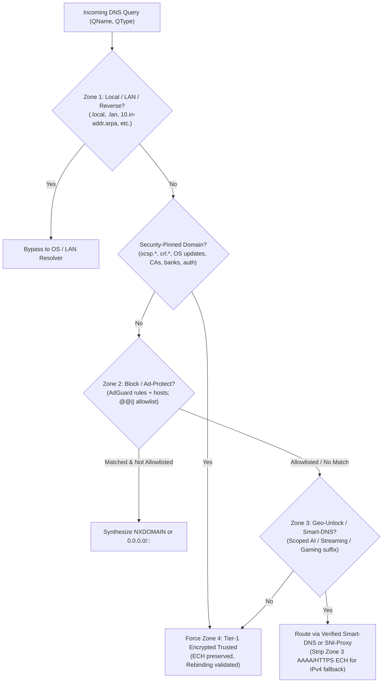
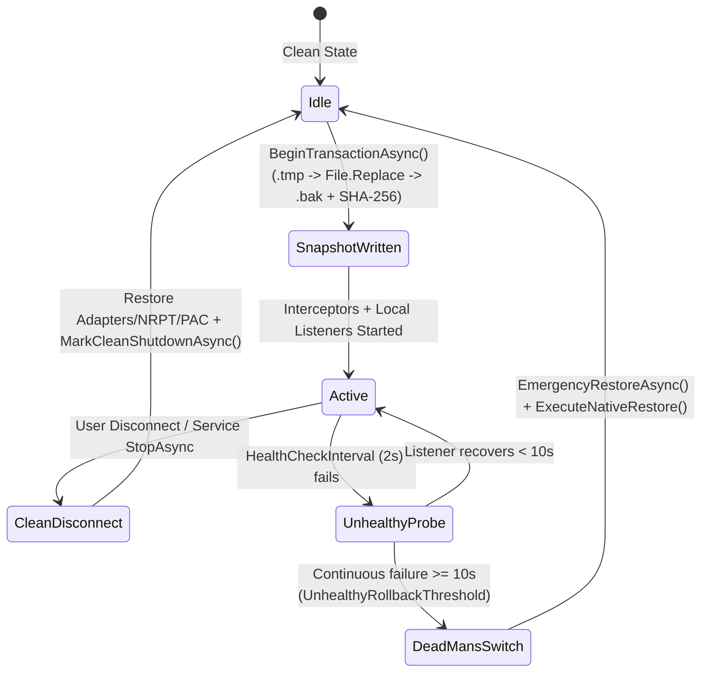

# PulseCore v2.0 Architecture

DNS Pulse v2.0 (**PulseCore**) is a modular `.NET 9` local encrypted DNS router, 4-zone split-namespace engine, driverless TLS-split PAC sidecar, and crash-safe Windows networking daemon.

## 1. 5-Project Layering

PulseCore enforces strict one-way dependency boundaries across five projects in `src/`:

```text
                   ┌──────────────────────────┐
                   │      DnsPulse.App        │  WPF + WPF-UI 4.3.0 desktop client (asInvoker)
                   │  (net9.0-windows10.0)    │  Communicates via ACL-hardened Named Pipe
                   └────────────┬─────────────┘
                                │
          ┌─────────────────────┴─────────────────────┐
          ▼                                           ▼
┌──────────────────────────┐               ┌──────────────────────────┐
│    DnsPulse.Service      │               │ DnsPulse.Platform.Windows│
│  Windows Service Host    │──────────────►│ Win32 Interop, NRPT, COM │
│  + Dead-Man's Switch     │               │ Firewall, Snapshot, IPC  │
└────────────┬─────────────┘               └────────────┬─────────────┘
             │                                          │
             └──────────────────┬───────────────────────┘
                                ▼
                   ┌──────────────────────────┐
                   │     DnsPulse.Engine      │  Transports (DoH/DoH3/DoT/DoQ/DNSCrypt/ODoH)
                   │        (net9.0)          │  Optimistic Cache, Pool, 6-Layer Doctor,
                   └────────────┬─────────────┘  TLS-Split PAC Sidecar, VPS Generator
                                │
                                ▼
                   ┌──────────────────────────┐
                   │      DnsPulse.Core       │  Zero-OS-dependency pure domain models,
                   │        (net9.0)          │  RFC 1035/8484/9460 wire codec, Radix tries,
                   └──────────────────────────┘  4-Zone Router, DNSCrypt v2 Stamps, Ed25519
```

| Project | Target Framework | Responsibilities |
|---|---|---|
| `DnsPulse.Core` | `net9.0` | Wire codec (`DnsWireCodec`, `PooledDnsPacket`, `HttpsSvcbRouteRewriter`), radix tries (`DomainRadixTrie`, `CidrRadixTrie`), `SplitNamespaceRouter`, `IpSafetyInspector`, `DnsRebindingValidator`, `DnsStampCodec` (`sdns://`), `Ed25519Verifier`, `SignedManifestVerifier`, `BuiltInCatalogPresets`. |
| `DnsPulse.Engine` | `net9.0` | Upstream transports (`DohDnsClient`, `DotDnsClient`, `DoqDnsClient`, `DnsCryptClient`, `OdohClient`, `UdpTcpDnsClient`, `DdrDiscoveryClient`, `TlsFragmentingStream`), `EncryptedBootstrapResolver`, `OptimisticDnsCache` (RFC 8767 serve-stale), `UpstreamPoolManager`, `PulseCoreDnsEngine`, `LocalDnsServer`, `LocalDohHttpListener`, `TlsFragmentationProxyServer`, `AutoPacServer`, `SixLayerDiagnosticEngine`, `SelfHostedVpsGenerator`, `SignedFeedSyncService`. |
| `DnsPulse.Platform.Windows` | `net9.0-windows10.0.19041.0` | Win32 DNS interop (`Win32NetworkInterop`, `Port53ConflictInspector`, `LoopbackPortSelector`), COM firewall (`FirewallComManager`), `NrptPolicyManager`, `SmhnrPolicyManager`, `BrowserDohInspector`, `AntiCheatGuard`, `NetworkSnapshotJournal`, `PipeSecurityBuilder`, `PulsePipeIpcServer`/`Client`, `VerifiedAppUpdateService`, `DiagnosticBundleExporter`. |
| `DnsPulse.Service` | `net9.0-windows10.0.19041.0` | `DnsPulseWorkerService` (`DnsPulseService`), `DefaultPulseRuntimeBackend`, `PulseServiceOptions`, Dead-Man's Switch health monitor. |
| `DnsPulse.App` | `net9.0-windows10.0.19041.0` | Unprivileged (`asInvoker`) WPF desktop UI (`WPF-UI` 4.3.0, `CommunityToolkit.Mvvm`), system tray & autostart management, emergency `--restore-network` recovery entry point. |

---

## 2. 4-Zone Split-Namespace Precedence

Every DNS query entering `PulseCoreDnsEngine` is classified deterministically by `SplitNamespaceRouter` using atomic, lock-free radix-trie snapshots (`Volatile.Read` / `Interlocked.Exchange`):



### Zero-Trust Zone 4 Invariant

`TrustTierPolicy.CanServeDefaultInternet(TrustTier, DnsProtocol)` strictly forbids unencrypted resolvers (`Udp`, `Tcp`), `SniProxy`, and `Tier4ExperimentalLab` servers from serving Zone 4 default internet traffic. Only verified `Tier1EncryptedTrusted` endpoints (`DoH`, `DoH3`, `DoT`, `DoQ`, `DnsCrypt`, `AnonymizedDnsCrypt`, `ODoH`) are permitted in the Zone 4 `UpstreamPoolManager`.

---

## 3. `HTTPS (65)` / `SVCB (64)` ECH Handling

Modern browsers (Chrome, Edge, Firefox) query `HTTPS` (type `65`) and `SVCB` (type `64`) records containing **Encrypted Client Hello (`SvcParamKey.Ech = 5`)** payloads and IPv4/IPv6 hints.

`HttpsSvcbRouteRewriter.Rewrite(DnsMessage, bool geoUnlockIpv4Only)` applies zone-aware policy:

- **Zone 4 (Default Encrypted Internet — `geoUnlockIpv4Only: false`):**
  - **Preserves `Ech` (`key=5`), `Alpn`, `Port`, `Ipv4Hint`, and `Ipv6Hint`** so browsers gain full Encrypted Client Hello privacy against SNI inspection.
- **Zone 3 (Geo-Unlock / SNI-Proxy — `geoUnlockIpv4Only: true`):**
  - Strips `Ech` (`key=5`) and `Ipv6Hint` (`key=6`) from `HTTPS`/`SVCB` records (and synthesizes `NODATA` for `AAAA` / `HTTPS` when backed by an IPv4 `SniProxy`), forcing the client onto standard TLS 1.3 ClientHello SNI over IPv4 so the Smart-DNS / SNI-Proxy or local TLS-Split sidecar can inspect and relay or fragment the SNI cleanly.

---

## 4. Driverless TLS-Split PAC Sidecar

When an ISP resets connections by inspecting the TLS `ClientHello` SNI header on TCP port 443 (`TlsSniDpiReset`), PulseCore bypasses DPI **without requiring kernel drivers** (safe alongside kernel anti-cheats):

1. **`AutoPacServer`** (`127.0.53.1:10809` by default) serves `/proxy.pac` (`FindProxyForURL`) with an atomically updated list of split-tunnel domains routed to `PROXY 127.0.53.1:10808; SOCKS5 127.0.53.1:10808; DIRECT` while returning `DIRECT` for everything else.
2. **`WinInetProxyManager`** registers `AutoConfigURL` in `HKCU\Software\Microsoft\Windows\CurrentVersion\Internet Settings` and triggers `InternetSetOption` (`INTERNET_OPTION_SETTINGS_CHANGED` / `REFRESH`).
3. **`TlsFragmentationProxyServer`** (`127.0.53.1:10808`) accepts HTTP `CONNECT`, plain HTTP proxy, and SOCKS5 `CONNECT` streams:
   - Resolves targets using `IBootstrapResolver` and enforces `IpSafetyInspector.IsPrivateOrBogon` SSRF blocking (`BlockPrivateDestinationIps = true`).
   - Sets `Socket.NoDelay = true` and uses `TlsClientHelloInspector` to locate the exact SNI extension offset (`SniExtensionOffset` / `ServerNameOffset`).
   - Splits the outbound `ClientHello` TCP write cleanly across the SNI boundary (`SplitAtSni = true`, `FragmentChunkSize`) before relaying full-duplex traffic.
4. **LAN Gateway Sharing:** `LanGatewayDescriptor` + `QrMatrixGenerator` can optionally expose DNS + PAC + Proxy endpoints to mobile devices on the same LAN via a self-contained ISO/IEC 18004 QR code.

---

## 5. Named Pipe ACL Split (`DnsPulse.App` ↔ `DnsPulse.Service`)

`DnsPulse.App` runs strictly unprivileged (`requestedExecutionLevel level="asInvoker"`). Privileged Windows networking mutations (NIC DNS assignment, NRPT policies, COM Firewall rules, SMHNR policy) are isolated inside `DnsPulseService` (`DnsPulse.Service.exe`):

- **Transport:** `NamedPipeServerStreamAcl.Create` on `\\.\pipe\DnsPulse.Control.v1` (`PipeSecurityBuilder.DefaultPipeName`).
- **Hardened DACL:** `PipeSecurityBuilder.CreateRestrictedPipeSecurity` disables inheritance and grants `FullControl` **exclusively** to:
  1. `LocalSystemSid` (`NT AUTHORITY\SYSTEM`)
  2. `BuiltinAdministratorsSid` (`BUILTIN\Administrators`)
  3. The specific interactive user SID (never `Everyone` / `WorldSid`, `AnonymousSid`, or `BuiltinGuestsSid`).
- **Framing & Allowlist:** `PulsePipeIpcServer` enforces 4-byte little-endian length-prefixed UTF-8 JSON frames capped at **1 MiB** (`1,048,576` bytes) and validates every request against the canonical `PipeCommandNames` allowlist (`GetStatus`, `Connect`, `Disconnect`, `EmergencyRestore`, `ApplyProfile`, `RunDiagnostics`, `UpdateBlocklist`, `GetRecentTelemetry`, `ExportBundle`, `ShutdownService`).

---

## 6. Dead-Man's Switch & Crash-Safe Recovery

DNS Pulse guarantees that a crash, power loss, or hung listener never leaves Windows DNS broken:



1. **Atomic Snapshot Journal (`NetworkSnapshotJournal`):** Before modifying any adapter or policy, PulseCore captures `PrePulseNetworkSnapshot` (per-adapter IPv4/IPv6 DNS & DHCP flags, `PriorSmhnrDisabled`, `PriorNrptRuleNames`, SHA-256 integrity checksum) to `%ProgramData%\DnsPulse` (falling back to `%LOCALAPPDATA%\DnsPulse`) using write-through temp files and `File.Replace` backup rotation.
2. **Dead-Man's Switch (`DnsPulseWorkerService`):** Polls `ProbeListenerHealthAsync` every **2 seconds**. If local DNS/DoH/Sidecar listeners remain continuously unhealthy for **10 seconds**, the watchdog invokes `EmergencyRestoreAsync`, restoring original NIC DNS/DHCP settings, removing `PulseCore_*` NRPT rules, restoring SMHNR, clearing WinINet `AutoConfigURL`, and flushing the Windows DNS resolver cache (`dnsapi.dll`).
3. **Emergency CLI & Startup Recovery:** On startup after an unexpected reboot (`DirtyShutdown == true`), or anytime the user runs **`DnsPulse.exe --restore-network`** (including via the Start Menu **"Emergency Network Restore"** shortcut or uninstaller rollback), `RecoverIfDirtyAsync` / `ExecuteNativeRestore` immediately restores clean network state using native Win32/Registry APIs without spawning `netsh.exe` or `powershell.exe`.
