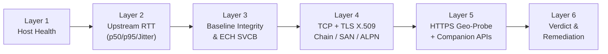

# 6-Layer Availability Doctor & Diagnostics Guide

Traditional DNS tools only send an ICMP `ping` to `1.1.1.1` or `8.8.8.8`. That does not tell you whether your ISP is poisoning answers, resetting TLS connections on SNI inspection, blocking encrypted DNS ports, or whether a target service is returning an HTTP geo-block.

PulseCore's **`SixLayerDiagnosticEngine`** runs an end-to-end 6-layer probe to pinpoint the exact failure layer and prescribe a concrete fix.

---

## 1. The 6 Diagnostic Layers

1. **Layer 1 — Host Network Health (`IHostNetworkHealthProvider`):**
   - Checks active physical NICs, IPv4/IPv6 connectivity, Windows NCSI status, local **UDP/TCP Port 53 occupants** (`Port53ConflictInspector`), Windows **SMHNR** (`DisableSmartNameResolution`), and **Browser DoH Bypass** (`BrowserDohInspector` for Chrome, Edge, Firefox).
2. **Layer 2 — Multi-Sample Upstream RTT:**
   - Measures real DNS resolution against the selected `DnsServerEntry` (DoH/DoH3/DoT/DoQ/DNSCrypt/ODoH/UDP/TCP), computing `LatencyP50Ms`, `LatencyP95Ms`, `JitterMs`, and packet loss.
3. **Layer 3 — Baseline Integrity & ECH Check:**
   - Compares answers against `IBootstrapResolver` baseline queries, flags bogon/sinkhole/hijacked IPs (`IpSafetyInspector`, `DnsRebindingValidator`), detects poisoned `NXDOMAIN` responses, and checks `HTTPS (65)`/`SVCB (64)` ECH availability.
4. **Layer 4 — Fail-Closed TCP & TLS Handshake:**
   - Connects over TCP + `SslStream` with `TargetHost = domain`, validating OS-trusted X.509 certificate chains and Subject Alternative Names (SANs) plus ALPN negotiation (`h2`, `http/1.1`). Never ignores certificate errors.
5. **Layer 5 — HTTPS Geo-Probe & Companion APIs:**
   - Issues an HTTP probe (`GET /`) inspecting status codes (`403`, `451`, `502–524`), geo-block redirect locations (`/available-regions`, `/sorry/index`), headers (`CF-Mitigated`, `X-Geo-Block`), response body markers (capped at 8 KiB), and companion endpoints (`AntiDirectAndGeoSignatures.GetCompanionDomains`).
6. **Layer 6 — Deterministic Verdict & Remediation:**
   - Maps observed signals into one of the `DiagnosticVerdict` states and emits a `RecommendedRemediation`.

---

## 2. Diagnostic Verdicts & Remediations

| `DiagnosticVerdict` | What It Means | `RemediationActionKind` | How to Fix |
|---|---|---|---|
| `Healthy` | DNS, TLS, and HTTPS all passed cleanly. | `None` | No action needed. |
| `LocalPort53Conflict` | Another local service (e.g., `dnscrypt-proxy`, VMware/WSL NAT, `Acrylic`, `AdGuard`) holds `127.0.0.1:53`. | `FixLocalPort53Conflict` | Let `LoopbackPortSelector` bind `127.0.53.1..10`, switch to `SplitNrpt`, or stop the conflicting service identified by `Port53OccupantName`. |
| `BrowserDohBypass` | Chrome, Edge, or Firefox has its own built-in DoH provider enabled, bypassing Windows/PulseCore DNS. | `DisableBrowserDohOverride` | Disable "Use secure DNS" in browser settings or apply DNS Pulse's browser DoH policy toggle (`BrowserDohInspector`). |
| `DnsPoisoned` | Upstream returned a bogon, loopback, sinkhole, or forged `NXDOMAIN` compared to encrypted baseline. | `SwitchToDoQOrFragmentedDoh` | Switch Zone 4 to a verified `Tier1EncryptedTrusted` DoH/DoQ/DNSCrypt resolver. |
| `EncryptedDnsDpiBlocked` | ISP DPI is blocking or throttling standard DoH/DoT connections to the resolver. | `SwitchToDoQOrFragmentedDoh` | Enable **TLS ClientHello Fragmentation** (`TlsFragmentingStream`), switch to **DoQ** (`DnsProtocol.DoQ`) or **ODoH**, or import a self-hosted VPS node. |
| `TlsSniDpiReset` | DNS resolved cleanly, but ISP DPI injected a TCP `RST` or timed out during the TLS `ClientHello` SNI handshake on port 443. | `EnableTlsSplitPacForDomain` | Enable the **Driverless TLS-Split PAC Sidecar** (`TlsFragmentationProxyServer` + `AutoPacServer`) for this domain. |
| `TlsMitmRejected` | TLS handshake presented an untrusted, expired, or mismatched X.509 certificate (captive portal, corporate proxy, or active MITM). | `SwitchToDoQOrFragmentedDoh` | **Do not bypass.** Verify you are not behind a captive portal; inspect certificate issuer or switch networks/resolvers. |
| `GeoBlockedByService` | Destination IP is reachable and TLS succeeded, but the origin service returned HTTP `403`/`451` or a regional restriction page (or direct CDN IP without proxy). | `RouteViaVerifiedGeoUnlock` | Add the domain to **Zone 3 (Geo-Unlock)** backed by a verified `Tier2VerifiedGeoUnlock` Smart-DNS / SNI-Proxy or a `Tier3CustomOrSelfHosted` VPS. |
| `IpBlockedByIsp` | Direct TCP connection to the authentic origin IP is blackholed/dropped at the IP/ASN routing layer by the ISP. | `DeploySelfHostedVps` | DNS/SNI splitting cannot bypass full IP null-routing. Route the domain through a self-hosted SNI-Proxy VPS (`SelfHostedVpsGenerator`) or a full-tunnel VPN. |
| `Unknown` | Insufficient or cancelled probe data. | `None` | Re-run diagnostics with network connectivity active. |
